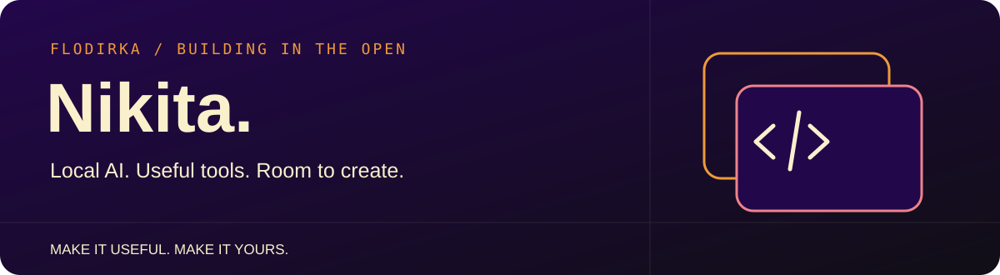
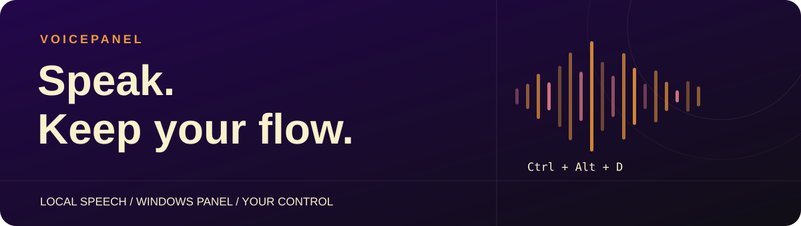
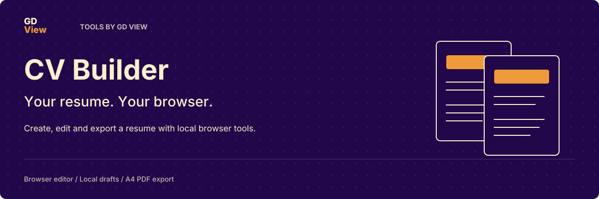
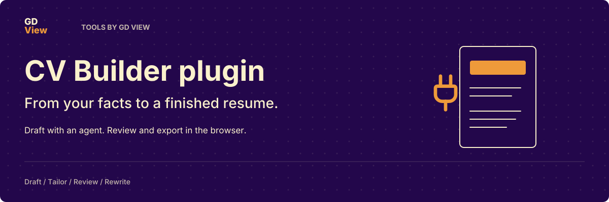
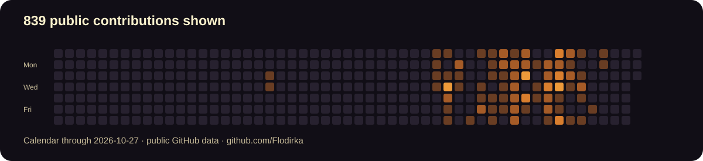

  

  I make games and tools for making games. 
  I'm curious about local AI and how it can help with creative work.

  
  

## Currently building: VoicePanel

Speak into the app you are already using. VoicePanel combines a compact Windows panel with a local speech API: continuous dictation, sentence correction, Russian/English translation, review before insertion, and voice playback.

**C++20 · Qt · Python · Local inference**

[Explore the source](https://github.com/Flodirka/VoicePanel) · [Get started](https://github.com/Flodirka/VoicePanel/blob/main/docs/getting-started.md) · [Future direction](https://github.com/Flodirka/VoicePanel/blob/main/ROADMAP.md)

## More things I build

### [CV Builder Web](https://github.com/Flodirka/cv-builder-web)

Create, edit and export a resume in the browser. Local drafts and PDF export stay in the browser. An optional agent handoff brings a draft into the same editor.

[Open the editor](https://flodirka.github.io/cv-builder-web/) · [Source](https://github.com/Flodirka/cv-builder-web)

### [CV Builder plugin](https://github.com/Flodirka/cv-builder-plugin)

Four resume-writing workflows and an MCP connection to the browser editor: draft, tailor, review and rewrite.

[Installation and source](https://github.com/Flodirka/cv-builder-plugin#install)

## Contributions

A dated snapshot of the public contribution calendar. [See the live graph and full history on GitHub](https://github.com/Flodirka?tab=overview).

## Support my work

If one of these tools helps you, you can support the time spent building and maintaining it.

  
  
  

Support is voluntary. Choose the external service that works for you.

[README asset notices](assets/NOTICES.md) · Inter and Lucide.
